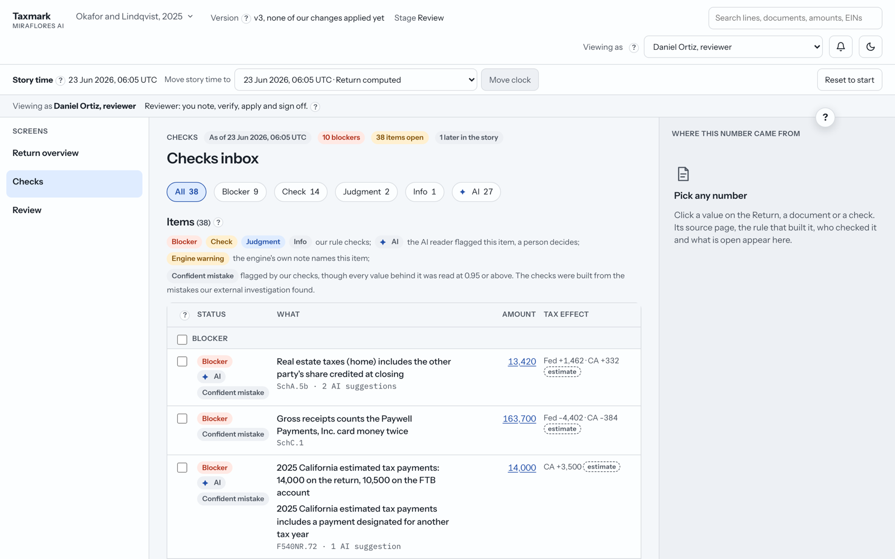
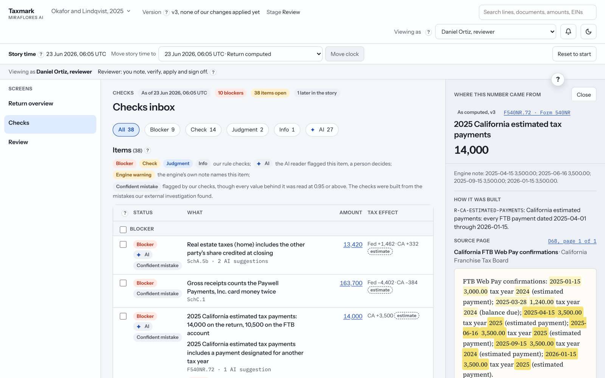
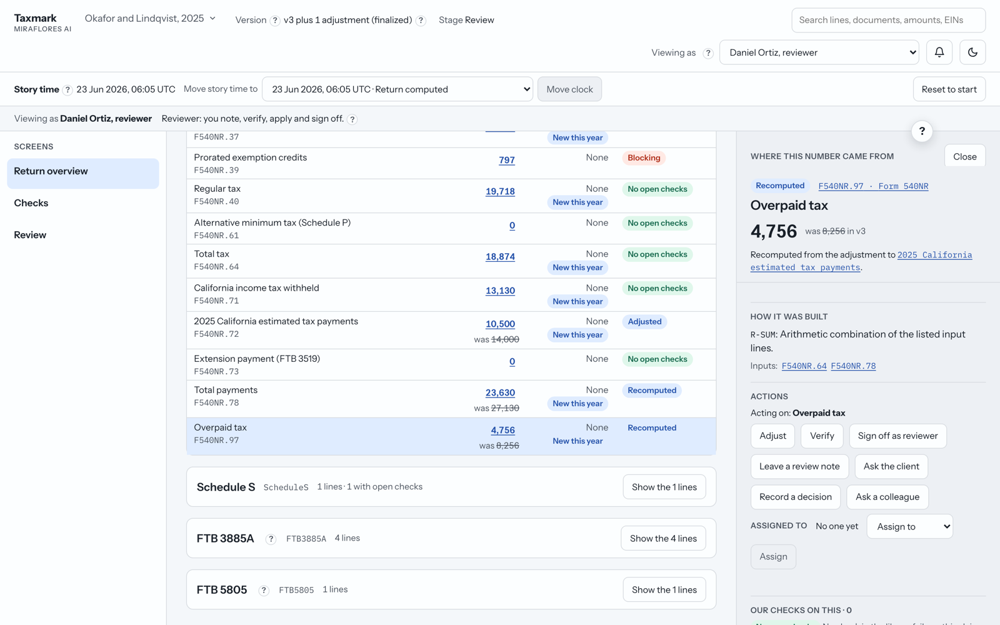
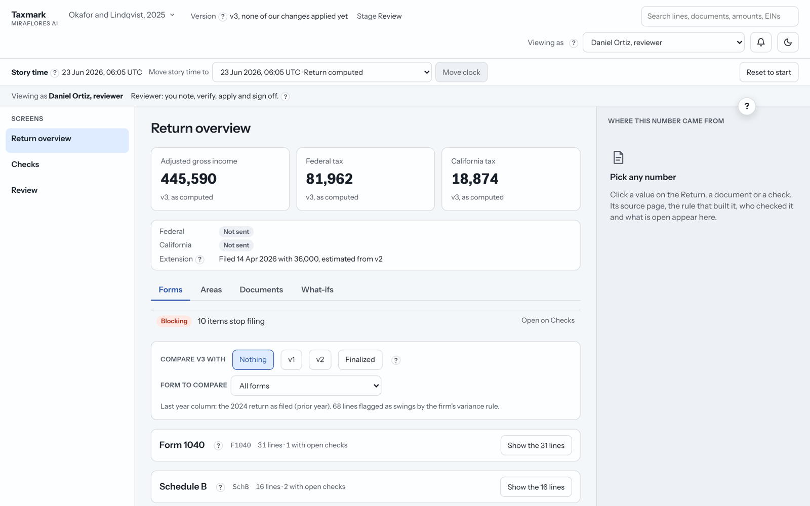
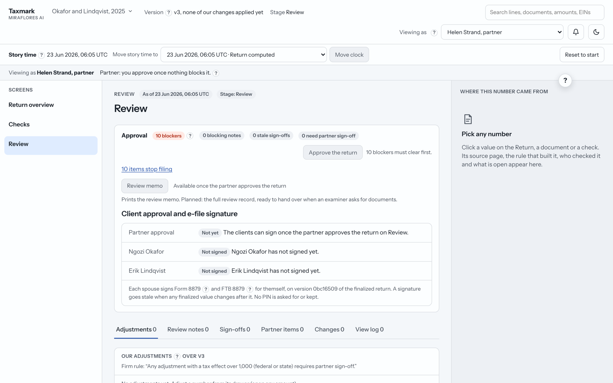
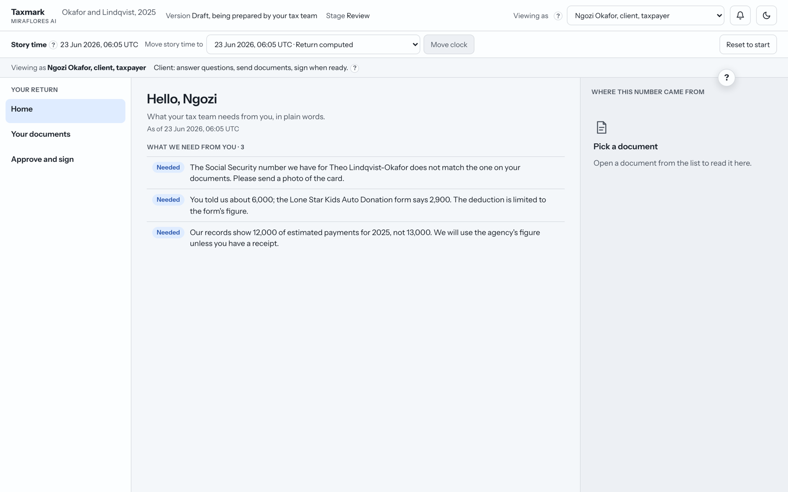

# Taxmark

**A web-native tax workpaper where every number carries its receipt.**

Tax software reads documents and grades its own confidence, and a number read with high confidence can still be wrong. Taxmark doesn't take that confidence on trust: it traces every figure on a return back to its source and tests it against independent records before anyone signs.

**[Try the live app →](https://taxmark-workpaper.vercel.app)**  ·  **[Watch the walkthrough →](https://youtu.be/zmIw8VWhetk?si=EzImnV-pkf5X-I1B)**

[](https://youtu.be/zmIw8VWhetk?si=EzImnV-pkf5X-I1B)

> Built as a case study: redesign the tax workpaper for one invented household's 2025 return, from a packet of documents, extracted values and three computed versions of the return. The packet hides confident mistakes, and finding them was part of the job.

---

## The idea

Click any number and Taxmark answers four questions:

1. **Where did it come from?** The source document, page and field.
2. **What was done to it?** The rule that built it, and any change with who, why and the tax effect.
3. **Who checked it?** Sign-offs bound to the exact value that was signed.
4. **What is still open?** The checks it fails, and whether they block filing.

## What it looks like

### Checks: everything that needs attention, in one inbox
Each row is a line on the return. Pills show who raised it: our rule checks, the AI reader, the engine's own warning, and **Confident mistake** when a check caught a value the reading software was sure about.



### Where this number came from
One click opens the side panel: the source page with the exact values highlighted, how the number was built, and the actions you can take on it.



### A fix flows through
The reviewer corrects California's estimated payments to match the state's own record. The totals recompute, the refund updates, and every changed line shows what it was before.



### Return overview
The return form by form, with the status of every line and a comparison against earlier versions and last year.



### Review and approval
The partner approves only when nothing blocks, then each client signs the e-file authorization for the finalized version.



### The client's view
Clients see what their tax team needs from them in plain words, with no internal jargon and sensitive IDs masked.



---

## How it works

**One packet, read three ways**

| Reader | Where | Job |
|---|---|---|
| **Deterministic checks** | In the app | Compare values against independent sources: agency payment records, the printed page, the prior year, the client's answers, legal limits. They decide what blocks filing. |
| **AI reader** (Claude) | In the app, as a background job | Reads free text that rules can't, such as notes and client answers. Code verifies every quote word for word, and a person accepts or dismisses each suggestion. It never blocks filing. |
| **Answer key** | Outside the app | A ledger of the mistakes found by an independent investigation. It tests the checks and grades the AI, and never creates a finding. |

**Read-only underneath, everything on top**

- The client packet is never edited.
- Every action (an adjustment, note, sign-off, question or undo) is an event in an append-only log. An undo is a new event, so nothing is lost.
- Each screen is the packet plus the log, replayed for one role at one point in time. The audit trail is the data itself.

**What it catches, and what it doesn't**

- Totals that don't add up, re-added from their inputs on every return.
- Numbers that disagree with another source: payments against the IRS and state records, printed against read, money counted twice, a blank read as zero, this year against last year, amounts over a limit.
- The engine's own warnings, shown on the line they're about.
- Taxmark is a review tool, not a second tax engine. Lines that need real tax computation are marked "Needs engine re-run" and block approval until the engine runs again.

## Roles

A role switcher shows the same return as each person sees it. The server enforces what each role may do.

| Role | Can |
|---|---|
| Preparer | Propose adjustments, verify, leave notes |
| Reviewer | Apply adjustments, sign off (never on their own change) |
| Partner | Approve the return once nothing blocks |
| Clients | Answer questions, send documents, sign the e-file authorization |
| Examiner | Read-only access to the items under examination |

A story clock moves the whole workspace through the return's timeline: past points are view-only, and the as-filed return locks once the agency accepts it.

## Tech stack

- **Next.js on Vercel**: one codebase for the pages and the server logic.
- **Postgres (Neon)** for the event log; the app only ever inserts and reads.
- **Vercel Blob (private)**: the packet is sealed with AES-256-GCM, loaded by pointer and refused if its hash doesn't match.
- **Claude** as the AI reader, run by a scheduled function with identifiers masked; its output is sealed beside the packet.
- **Vitest** unit tests (one per known mistake), **Playwright** browser tests per role, and a CI gate that fails the build if an AI suggestion isn't grounded in its source.

## Trade-offs

| Decision | What it cost |
|---|---|
| Rules decide; the AI only suggests | The AI misses things, so the rules carry the load |
| Checks written against the schema, not a document | Checks that depend on free-text wording can miss phrasing they haven't seen |
| Replay the whole event log | Simple and fine for one return; a firm would need snapshots |
| Fixes flow through plain sums only | Lines needing tax computation wait for an engine re-run |
| A role switcher instead of sign-in | Identity is self-declared; real sign-in comes first before production |

## Run it locally

```bash
cd project-build
npm install
npm run dev        # http://localhost:3000
```

Locally the event log is written to files under `project-build/.data/`, so no database is needed.

```bash
npm test           # unit tests
npm run e2e        # browser tests (builds and starts the app)
npm run typecheck
```

## Repository

```
case-study-project-package/   the brief and the client packet, as delivered (read-only)
project-build/                the app: src/domain (checks, events, policy), src/components, tests/
docs/
  handin/                     the brief, errors found, data model, AI scorecard, architecture graphs
  ground-truth/               the ledger of confident mistakes found in the packet
  decisions.md                every decision, with its trade-off, logged as it was made
  ai-usage.md                 what each AI tool or model did
```

Further reading: [errors found](docs/handin/errors-found.md) · [core idea and data model](docs/handin/core-idea-and-data-model.md) · [how AI was used](docs/handin/how-ai-was-used.md) · [AI scorecard](docs/handin/ai-scorecard.md)

## How it was built

Built by Aarvin George with AI pair-programming. Claude Opus wrote code test-first, and a different model (Claude Fable) reviewed each major round by probing the live app. Every decision, including the corrections, is in [docs/decisions.md](docs/decisions.md), and every tool's role is in [docs/ai-usage.md](docs/ai-usage.md).
